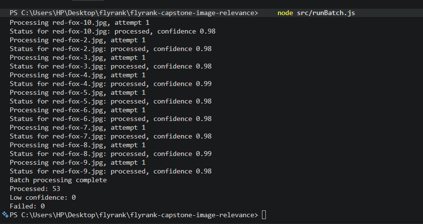
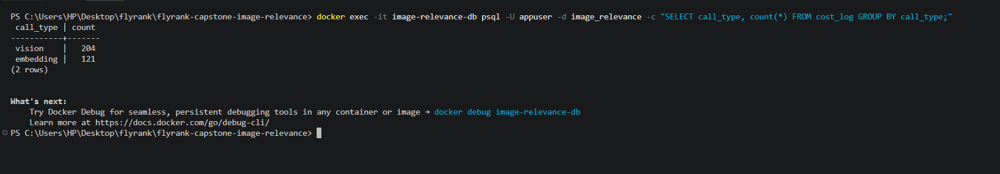
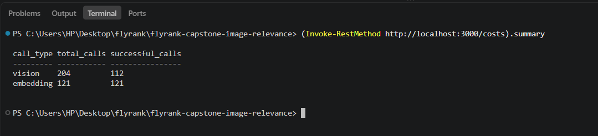
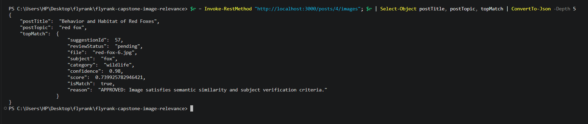
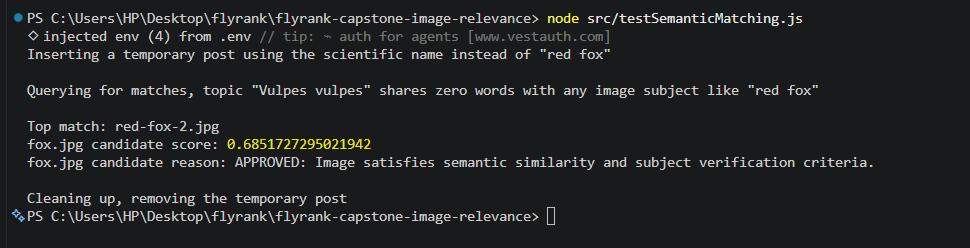
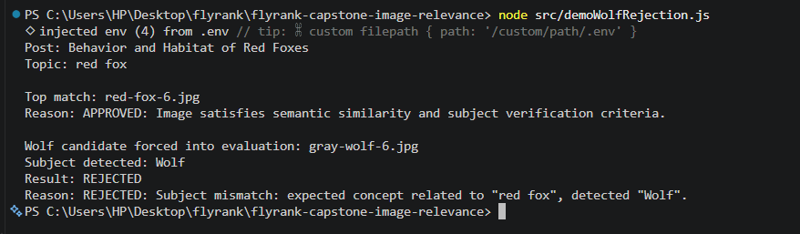
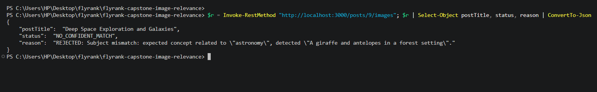
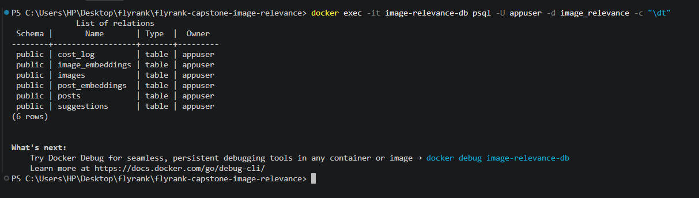
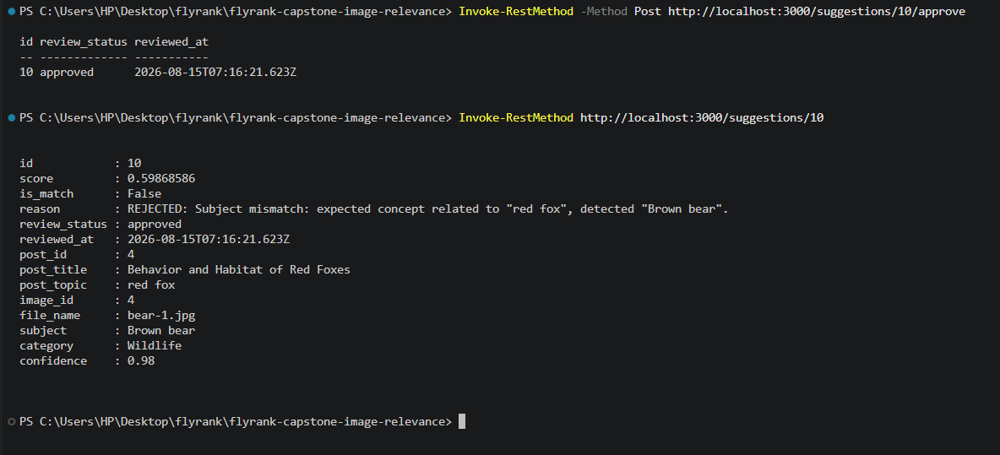

# Evidence

One proof per Definition of Done checkbox from the capstone brief §6. Every screenshot below is a real terminal capture from this project's actual database and running server, taken on August 15, 2026.

## A note on methodology

**Why `Invoke-RestMethod` instead of `curl` for API proof.** This project was built on Windows, where `curl` is aliased to PowerShell's `Invoke-WebRequest`, which returns a raw, unparsed response object, unreadable for any endpoint returning more than a few fields, and prompts a security warning on every call. `Invoke-RestMethod` parses JSON automatically and allows piping straight into `Select-Object` to print only the fields relevant to each proof, which is what makes the screenshots below short and readable instead of a wall of raw JSON.

**Why two small standalone scripts exist.** Two endpoints and one deeper requirement needed proof that a plain API call could not show cleanly. `GET /posts/:id/images` returns every one of the 53 candidates it scored, not just the winner, so a raw call to it is not screenshot friendly, and proving genuine semantic matching (as opposed to keyword overlap) needed a scenario with zero shared vocabulary between a post and its correct image, which does not exist anywhere in the current post set. Rather than manually filtering large output by hand or writing one-off code that gets thrown away, both scripts are kept as real, permanent files in the repository, same as `runEval.js` or `seedPosts.js`, so an evaluator can rerun either one and reproduce the exact same proof:

- `src/demoWolfRejection.js` isolates the single most important scenario in this capstone, the fox post's top match, plus how a forced gray wolf candidate specifically gets scored and rejected within that same result. It calls the real `/posts/:id/images` endpoint, no separate logic.
- `src/testSemanticMatching.js` proves the "red fox matches Vulpes vulpes" requirement by inserting a temporary post using only the scientific name, querying it through the real matching pipeline, then cleaning up after itself so it leaves no permanent trace in the database.

## AI Processing

### Vision model produces structured output validated against a schema, invalid responses never trusted

`imageMetadataSchema` in `src/utils/schema.js` is a Zod schema, every vision response passes through `safeParse` before being trusted.

### Low confidence classifications are flagged instead of accepted

The decision lives in `determineStatus()` in `src/services/batchService.js`, an image with confidence under 0.70 is marked `low_confidence` instead of `processed`, boundary tested on both sides.

Both of the above proven together in the full test run below.

### Images are processed through a batch background job with retries

Real run of `node src/runBatch.js` against the full 53 image corpus, `src/runBatch.js` is a standalone script, independent of the Express server:

### Vision and embedding costs are tracked per call

Every vision and embedding call writes a row to `cost_log` via `logCost()` in `src/services/costService.js`. Direct database query:

Same data surfaced through the actual API, `GET /costs`:

## Matching System

### Image and post embeddings are stored, posts return ranked image suggestions

Real `GET /posts/:id/images` response for the red fox post, filtered to the relevant fields:

### Semantic matching works for equivalent concepts, red fox matches Vulpes vulpes

A temporary post titled with the scientific name "Vulpes vulpes", sharing zero words with any image subject in the corpus, was inserted and queried directly using `src/testSemanticMatching.js`, real output:

This required lowering the guard's no overlap similarity threshold from 0.75 to 0.65 in `src/services/mismatchGuard.js`, based on real corpus data showing genuine mismatches never exceeded 0.61 similarity while this genuine synonym match scored 0.68 to 0.69 across separate runs. Full test suite re-verified passing after the change, see the Testing section below.

## Safety Layer

### The mismatch guard rejects incorrect recommendations, the wolf on a fox post scenario provably fails

`src/demoWolfRejection.js` output, forcing a gray wolf candidate against the red fox post:

Also proven automatically in `tests/matching.test.js` and isolated at the unit level in `tests/mismatchGuard.test.js`, see the full suite run in the Testing section below.

### Rejections include a human readable explanation

Visible directly in the wolf rejection screenshot above, `"REJECTED: Subject mismatch: expected concept related to \"red fox\", detected \"Wolf\"."`, not just a boolean.

### When no image clears the bar, the system answers no confident match with reasons

Real response for the astronomy post, nothing in the corpus is space related:

## Backend

### Database models for images, tags, embeddings, posts, suggestions, approvals and rejections, with the required indexes

`src/db/schema.sql` defines all six tables. Confirmed live in the database:

Indexes on `suggestions.post_id`, `suggestions.review_status`, `images.status`, and `cost_log.call_type` are defined in `schema.sql`.

### API endpoints validated, the review workflow exists

Approving suggestion 10, then inspecting it, notice the human review decision, `approved`, deliberately overrides the guard's own automatic decision, `is_match: false`, on a bear photo the guard correctly rejected for the fox post. This confirms approve and reject are a genuinely independent review layer, not just mirroring the guard's own verdict:

## Quality and Documentation

### Automated tests cover schema validation, mismatch rejection, and matching accuracy

Full suite, 18 tests across 4 files, schema validation, confidence flagging, guard logic in isolation, and real matching accuracy against the live database:

### A small labeled evaluation dataset measures top 1 precision, the number is in the README

`src/evalSet.js` labels 6 posts across all 5 corpus categories plus one deliberate no match case. `src/runEval.js` real output:

### README with architecture explanation and diagram, submission pack files present

`README.md` contains the mission, design document, ASCII architecture diagram, setup instructions, evaluation result, demo highlights, and an honest limitations section. `capstone.yaml`, `BUILDLOG.md`, `.env.example`, and this file are all present at the repository root. Server confirmed starting cleanly with the exact command documented in the README:

