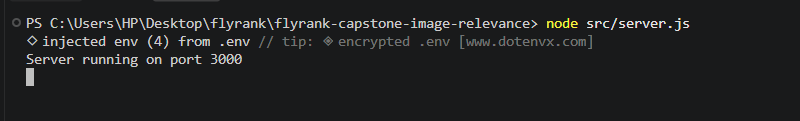
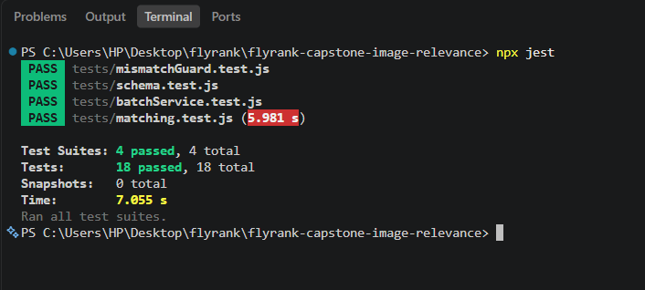
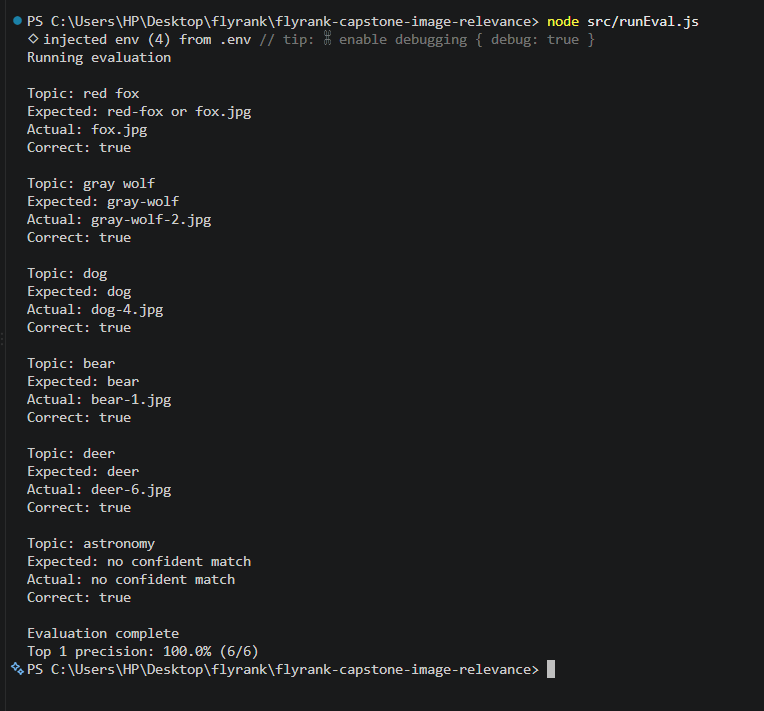

# FlyRank Capstone: AI Image Understanding & Content Matching Engine

## The Mission
A backend service that automatically tags an image library using Vision AI and semantically matches the right image to the right blog post. It features a "mismatch guard" that safely rejects images when it is not confident, prioritizing accuracy over forced recommendations.

## Design Document

### 1. Problem Statement
The goal is to match images to articles based on semantic meaning, not just keywords. Crucially, the system must recognize when no suitable image exists and refuse to provide a bad recommendation (e.g., rejecting a wolf image for an article about red foxes).

### 2. Image Metadata Schema
Every image processed by the Vision model produces structured output validated against this JSON schema before it is trusted:

```json
{
  "subject": "string",
  "category": "string",
  "attributes": ["string"],
  "caption": "string",
  "confidence": "number (0-1)"
}
```

### 3. Database Design

- **images** — one row per image: file name, subject, category, attributes, caption, confidence, and a `status` column (`processed` / `low_confidence` / `failed`)
- **image_embeddings** — one row per image, the caption embedding stored as a `float8[]`
- **posts** — blog post title, topic, and content
- **post_embeddings** — one row per post, the content embedding
- **suggestions** — one row per (post, image) evaluation: score, isMatch, reason, and a review status (`pending` / `approved` / `rejected`)
- **cost_log** — one row per vision or embedding call, attributed by reference and success

### 4. API Surface

- `GET /posts/:id/images` — calculates similarity ranking, passes candidates through the mismatch guard, and returns either a suggested image (ranked and explained) or a "no confident match" rejection
- `GET /suggestions/:id` — inspects why a suggestion was approved or rejected
- `POST /suggestions/:id/approve` — marks a suggestion as approved
- `POST /suggestions/:id/reject` — marks a suggestion as rejected
- `GET /costs` — returns attributed per call cost log entries plus a summary

### 5. Explicit Non-Goal
This project is explicitly **not** building a frontend user interface or a massive image search engine. The focus is strictly on the backend decision logic and the AI safety layer across a bounded dataset of ~50 images.

## Architecture

```
Images ──(batch job)──► Vision Model ──► tags, caption, confidence ──► images table
                          └──► embed(caption) ──────────────► image_embeddings table

Posts ─────────────────────────────► embed(post content) ────► post_embeddings table

GET /posts/:id/images
    └──► fetch post + images from DB
    └──► cosine similarity ranking
    └──► mismatch guard (confidence, similarity, subject overlap)
         ├──► suggested image, ranked and explained, saved to suggestions table
         └──► no confident match, with reason

Review endpoints (approve, reject, inspect) read and update the suggestions table.
Every vision and embedding call is logged to the cost_log table.
```

## Setup Instructions

**Requirements:** Node.js, Docker Desktop, a free Gemini API key from Google AI Studio, a free Pexels API key.

1. Clone the repository and run `npm install`.
2. Copy `.env.example` to `.env` and fill in `GEMINI_API_KEY` and `PEXELS_API_KEY`. `DATABASE_URL` and `PORT` already have working defaults matching the included `docker-compose.yml`.
3. Start Postgres:
   ```
   docker compose up -d
   ```
4. Apply the database schema:
   ```
   node src/db/migrate.js
   ```
5. Download the image corpus:
   ```
   node src/downloadImages.js
   ```
   Downloads 50 categorized animal photos from Pexels (red fox, gray wolf, dog, bear, deer), alongside the 3 images already included in the repo.
6. Seed posts and process the image corpus:
   ```
   node src/seedPosts.js
   node src/runBatch.js
   ```
   The batch job is deliberately paced to stay under the Gemini free tier's per minute quota. Expect this step to take several minutes for the full corpus.
7. Start the server:
   ```
   node src/server.js
   ```
   

8. Run the test suite:
   ```
   npx jest
   ```
9. Run the evaluation script for a top 1 precision measurement:
   ```
   node src/runEval.js
   ```

## Testing

Full test suite, 18 tests covering schema validation, low confidence flagging, mismatch guard logic, and real matching accuracy against the seeded corpus:

```
npx jest
```



## Evaluation Result

Top 1 precision measured against a 6 post labeled evaluation set: **100% (6/6)**.



See `EVIDENCE.md` for the full run output.

## Demo Highlights

- `GET /posts/:id/images` for the red fox post correctly ranks a red fox image first.
- Forcing a gray wolf image as a candidate against the red fox post gets rejected by the mismatch guard with a category mismatch explanation. Reproduce this directly with `node src/demoWolfRejection.js`.
- `GET /posts/:id/images` for the astronomy post returns "no confident match", since nothing in the corpus is space related.
- Semantic matching works on meaning, not just shared words, a post titled only with the scientific name "Vulpes vulpes" still correctly matches red fox images despite sharing zero vocabulary with any image's subject. Reproduce this directly with `node src/testSemanticMatching.js`.
- `POST /suggestions/:id/approve` and `/reject` persist a human review decision independent of the guard's own automatic decision.

See `EVIDENCE.md` for full proof of every item above, including screenshots and real API responses.

## Limitations

- The mismatch guard's subject overlap check uses simple word token matching rather than a true semantic subject comparison. It works well for the current corpus but could be fooled by categories with overlapping vocabulary.
- Posts are seeded manually through a script rather than through an API endpoint, there is no `POST /posts` route yet.
- The image corpus is limited to 5 animal categories plus a few unrelated control images. Real world category coverage would need a larger and more varied dataset.
- The Gemini free tier's per model daily and per minute quotas mean re-processing the full corpus from scratch is slow (several minutes) due to the pacing delay required to stay within limits.